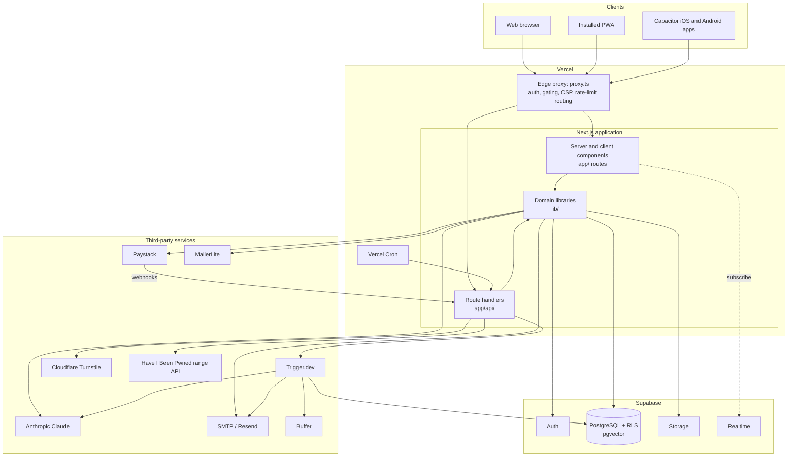
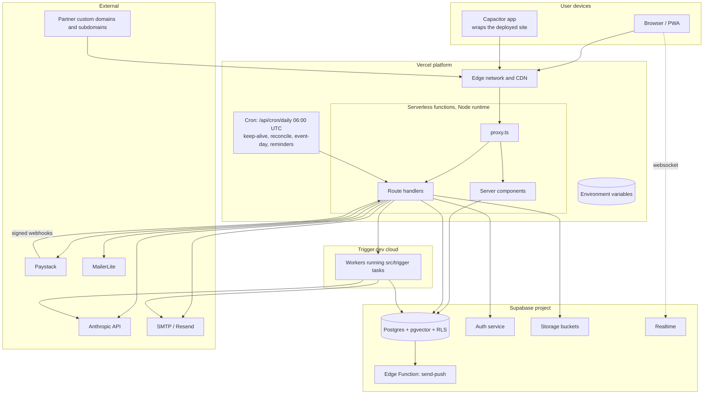
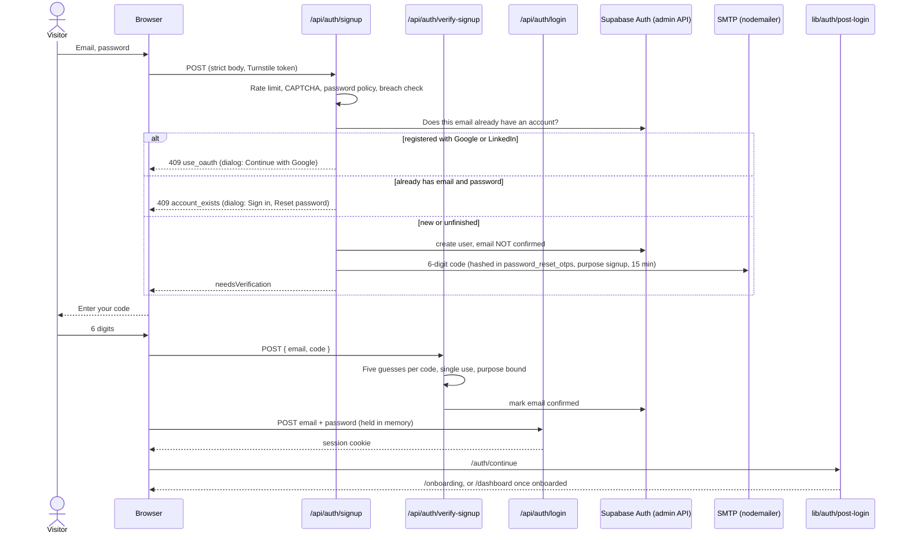
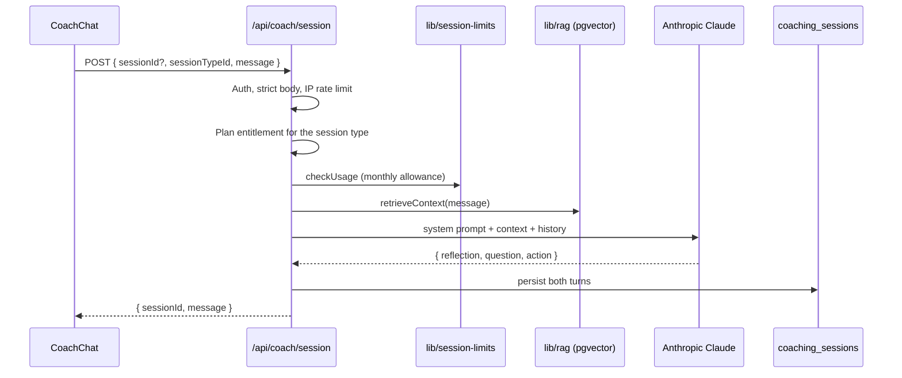
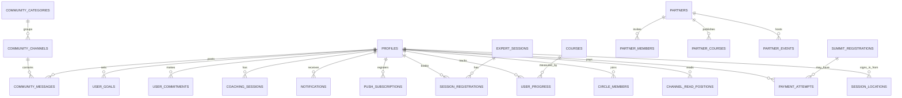

# Ascentor

Ascentor is a leadership-development platform for African professionals. Members get
a personal AI coach (Sage), a weekly accountability community (The Circle), live
expert sessions, a learning library, a goal and commitment tracker, and access to
The Elevation Summit. Organisations can run their own branded copy of the platform
through the white-label partner programme.

| | |
|---|---|
| Framework | Next.js 16 (App Router, Turbopack), React 19, TypeScript (strict) |
| Data | Supabase: PostgreSQL with Row Level Security, Auth, Storage, Realtime |
| AI | Anthropic Claude (Sage coach, admin intelligence), pgvector retrieval over a mentor knowledge base |
| Payments | Paystack (subscriptions, donations, products, partner subscriptions) |
| Background work | Trigger.dev tasks, Vercel Cron |
| Email | Nodemailer over SMTP, MailerLite (lists and automations), Resend via Trigger.dev |
| UI | Tailwind CSS 4, lucide-react icons, light theme only (the navigation sidebar is dark by design) |
| Validation | Zod 4, strict schemas on every API body |
| Mobile | Capacitor wrappers for iOS and Android |
| Hosting | Vercel (production), Supabase (managed) |

Documentation map: this file is the system documentation. Change tracking lives in
[CHANGELOG.md](CHANGELOG.md) (releases) and [wiki.md](wiki.md) (engineering log and deep dives).
Other references: [docs/api-contracts.md](docs/api-contracts.md) (generated request contracts),
[SECURITY.md](SECURITY.md), [CONTRIBUTING.md](CONTRIBUTING.md).

Contents

1. [System architecture](#1-system-architecture)
2. [Component diagram](#2-component-diagram)
3. [Use case diagram](#3-use-case-diagram)
4. [Deployment diagram](#4-deployment-diagram)
5. [Key flows](#5-key-flows)
6. [Modules and concerns](#6-modules-and-concerns)
7. [Data model](#7-data-model)
8. [API surface](#8-api-surface)
9. [Security model](#9-security-model)
10. [Configuration](#10-configuration)
11. [Development](#11-development)
12. [Testing and quality gates](#12-testing-and-quality-gates)
13. [Release policy and launch switch](#13-release-policy-and-launch-switch)
14. [Conventions](#14-conventions)
15. [Known gaps](#15-known-gaps)

---

## 1. System architecture

Ascentor is a single Next.js application. The edge proxy authenticates and gates
every request, server components and route handlers talk to Supabase and third
parties, and long-running or scheduled work is delegated to Trigger.dev and Vercel Cron.



Design principles:

- One deployable. No separate backend service; route handlers are the API.
- The database is the system of record and the last line of defence (RLS), not the application code alone.
- Every request body is validated by a strict Zod schema before it reaches business logic.
- Third-party failures degrade (email, CRM, geolocation fail open); payment and auth failures fail closed.

## 2. Component diagram

```mermaid
flowchart LR
    subgraph Presentation
        MKT[Marketing site<br/>app/ public pages]
        MEMBER[Member app<br/>app/(app)/]
        ADMINUI[Admin console<br/>app/admin/]
        PARTNERUI[Partner portal and tenant sites<br/>app/partner, app/p/]
        SHELL[Shells and navigation<br/>components/shell, nav]
        UIKIT[UI primitives and feature components<br/>components/]
    end

    subgraph Application
        PROXYC[proxy.ts]
        ROUTES[Route handlers<br/>app/api/**]
        VALID[Validation layer<br/>lib/validation]
        AUTHL[Auth services<br/>lib/auth]
        QUERIES[Data queries<br/>lib/supabase/queries]
    end

    subgraph Domain
        COACH[Coach: session types, limits, RAG<br/>lib/session-types, session-limits, rag]
        PLANS[Plans and entitlements<br/>lib/planTier, pricing, subscription*]
        PAYMENTS[Payments: settlement, reconciliation<br/>lib/payment*]
        COMM[Community: week, reactions<br/>lib/week, components/community]
        NOTIFY[Notifications: push and email<br/>lib/notify, push, reminders]
        SUMMIT[Summit: tickets, emails, event day<br/>lib/summit*, elevationSummit]
        PARTNERD[Partner: context, tiers, cache<br/>lib/getPartnerContext, partner*]
    end

    subgraph Infrastructure
        SB[Supabase clients<br/>lib/supabase]
        MAIL[Mail<br/>lib/email, nodemailer, mailerlite]
        JOBS[Background tasks<br/>src/trigger]
    end

    MKT --> ROUTES
    MEMBER --> QUERIES
    MEMBER --> ROUTES
    ADMINUI --> ROUTES
    PARTNERUI --> ROUTES
    SHELL --> UIKIT
    MEMBER --> UIKIT
    PROXYC --> AUTHL
    ROUTES --> VALID
    ROUTES --> AUTHL
    ROUTES --> COACH
    ROUTES --> PLANS
    ROUTES --> PAYMENTS
    ROUTES --> NOTIFY
    ROUTES --> SUMMIT
    ROUTES --> PARTNERD
    QUERIES --> SB
    AUTHL --> SB
    COACH --> SB
    PAYMENTS --> SB
    NOTIFY --> MAIL
    SUMMIT --> MAIL
    JOBS --> SB
    JOBS --> MAIL
```

## 3. Use case diagram

```mermaid
flowchart LR
    V([Visitor])
    M([Member])
    MOD([Moderator])
    A([Administrator])
    PO([Partner owner])
    PM([Partner member])
    SYS([Scheduler and webhooks])

    subgraph Public
        U1[Browse marketing pages and blog]
        U2[Join waitlist, newsletter, lead magnets]
        U3[Register for The Elevation Summit]
        U4[Donate to the Summit]
        U5[Watch the Summit stream]
        U6[Submit a partner enquiry or mentor application]
    end

    subgraph Account
        U7[Sign up with email or Google or LinkedIn]
        U8[Confirm email and sign in]
        U9[Reset a forgotten password with a one-time code]
        U10[Complete onboarding]
        U11[Manage profile, notifications, subscription]
        U12[Refer friends]
    end

    subgraph MemberApp[Member app]
        U13[See the dashboard: next step, goal, commitments, consistency]
        U14[Set and track a 90-day goal and weekly commitments]
        U15[Coach with Sage]
        U16[Check in and chat in The Circle]
        U17[Register for expert sessions]
        U18[Learn from courses and track progress]
        U19[Upgrade or cancel a plan]
    end

    subgraph Staff
        U20[Moderate community messages]
        U21[Manage users, roles, permissions]
        U22[Manage content, courses, events, billboards]
        U23[Review payments, reconcile, issue tickets]
        U24[Run AI agents and review intelligence]
        U25[Send newsletters and Summit emails]
    end

    subgraph Partner[Partner portal]
        U26[Apply for a branded platform]
        U27[Configure brand, domain, pricing]
        U28[Invite and manage members, courses, events]
        U29[Use the partner-branded coach and community]
    end

    subgraph Automated
        U30[Verify and settle payments, daily reconciliation]
        U31[Send reminders and event-day emails]
        U32[Summarise coaching sessions, research and draft content]
    end

    V --> U1 & U2 & U3 & U4 & U5 & U6 & U7 & U9
    M --> U8 & U10 & U11 & U12 & U13 & U14 & U15 & U16 & U17 & U18 & U19
    MOD --> U20
    A --> U20 & U21 & U22 & U23 & U24 & U25
    PO --> U26 & U27 & U28
    PM --> U29
    SYS --> U30 & U31 & U32
```



## 4. Deployment diagram



Environments:

| Environment | Branch | Purpose | Public sign-in |
|-------------|--------|---------|----------------|
| Production | `main` | Live marketing site and the Summit | Closed (gate) |
| Local (`npm run dev`) | `feat/platform-v1` | Full platform against the existing Supabase project, nothing deployed | Always open, no gate |
| Draft pull request | `feat/platform-v1` into `main` | Review only; not merged until after the Summit | n/a |

## 5. Key flows

### 5.1 Sign-up, verification, sign-in and routing

Email sign-up verifies the address with a one-time code sent through our own SMTP (nodemailer), once, at sign-up.
It is never asked for at ordinary sign-in. Google and LinkedIn sign-in skip the code (the provider already
verified the address).



Rules: an unconfirmed address never receives a session (enforced in `/api/auth/login` even if Supabase is set not
to require confirmation); a password sign-in against an account that only uses Google or LinkedIn answers
"please continue with Google" instead of a generic error; `next` and `redirect` parameters are reduced to same-site
paths by `safeNext()`. If Supabase redirects to the Site URL with `?code=` (its redirect allow-list did not
include `/auth/callback`), the proxy forwards it to `/auth/callback` so the sign-in still completes, and a
signed-in member opening the home page is sent to `/auth/continue` (onboarding or dashboard).

Errors that Supabase reports by redirecting with `error` parameters are shown in a dialog by
`components/AuthRedirectError.tsx` instead of only appearing in the address bar.

### 5.2 Password reset

One-time code flow, not a magic link: `/api/auth/forgot-password` stores an HMAC of a six-digit code (15
minute expiry, newest code only, five guesses, five codes per hour), emails it, and always answers
identically so the endpoint cannot be used to discover accounts. `/api/auth/reset-password` verifies the code
with an optimistic-lock attempt counter, enforces the password policy, updates the password, revokes every
session, and emails a "password changed" notice.

### 5.3 A Sage coaching message



### 5.4 Payment settlement

Checkout creates a `payment_attempts` row and a Paystack transaction. Settlement is idempotent and shared by
four triggers (client verify, Paystack webhook, admin "verify", daily reconciliation cron) through
`lib/paymentSettlement.ts`; webhook events are de-duplicated in `processed_webhook_events` and verified by
HMAC signature.

### 5.5 Dashboard data

`app/(app)/dashboard/page.tsx` fetches everything the first paint needs in one parallel pass
(`lib/supabase/queries/dashboard.ts`), and streams the secondary "Continue" rail (last Sage session, unread Circle
messages, unread notifications) behind a Suspense boundary. Goal progress is derived from milestone completion,
never stored separately; edits go through server actions that re-check the session and scope writes to the user.

## 6. Modules and concerns

### 6.1 Application layers

| Module | Path | Concern | Used by | Depends on |
|--------|------|---------|---------|------------|
| Edge proxy | `proxy.ts` | Authentication, route and API gating, 24 hour inactivity sign-out, CSP nonce, platform gate, admin MFA enforcement | Every request | `lib/auth`, `lib/launch`, Supabase SSR |
| Marketing site | `app/(marketing)`, `app/about`, `app/blog`, `app/free`, public pages | Acquisition, SEO, lead capture, Summit and donations | Visitors | `components/layout`, `lib/seo`, public APIs |
| Member app | `app/(app)/` | Dashboard, Coach, Circle, Sessions, Learn, Referral, Account (member since, sign-in methods, change password) | Members | `components/shell`, `lib/supabase/queries`, member APIs |
| Auth pages | `app/login`, `signup`, `forgot-password`, `reset-password`, `onboarding`, `admin-login`, `auth/` | Account lifecycle | Visitors, members, staff | `lib/auth`, `components/auth` |
| Admin console | `app/admin/` | Operations: users, content, payments, community, Summit, AI agents | Staff | Admin APIs, `lib/permissions` |
| Partner portal | `app/partner`, `app/partner-apply`, `app/p/[subdomain]` | White-label tenants | Partner owners and members | `lib/getPartnerContext`, partner APIs |
| Route handlers | `app/api/**` | HTTP API (see section 8) | All clients, webhooks, cron | `lib/*` |

### 6.2 Libraries (`lib/`)

| Module | Concern |
|--------|---------|
| `lib/validation/` | `http.ts` (parseJson, parseQuery), `common.ts` (primitives), `schemas/*` (auth, member, public, commerce, partner, admin), `registry.ts` (route to schema map) |
| `lib/auth/` | `account-lookup` (how an email signs in), `signup-otp` (issue and verify sign-up codes), `safe-next` (open-redirect guard), `post-login` (single post-login router), `password-policy` (rules and breach check), `rate-limit-shared` (Postgres-backed limits with memory fallback), `turnstile`, `login-security` (impossible-travel check), `revoke-sessions`, `admin-mfa` |
| `lib/supabase/` | Browser, server and service-role clients; `queries/` for page data (dashboard, coach) |
| `lib/launch.ts`, `lib/gate-client.ts` | The platform-open switch and the join/sign-in call to action |
| `lib/planTier.ts`, `pricing.ts`, `subscription*.ts` | Plan ranks, effective plan, prices, subscription state and webhook handling |
| `lib/session-types.ts`, `session-limits.ts`, `rag.ts` | Coach session catalogue, usage allowance per plan, retrieval over mentor knowledge |
| `lib/paymentSettlement.ts`, `paymentReconciliation.ts` | Idempotent settlement of Paystack payments and daily reconciliation |
| `lib/notify.ts`, `push.ts`, `reminders.ts`, `mobile-push.ts` | Unified notifications (push with email fallback), scheduled reminders |
| `lib/email.ts`, `emailTemplate.ts`, `nodemailer.ts`, `mailerlite.ts` | Transactional mail, branded templates, CRM sync |
| `lib/summit*.ts`, `elevationSummit.ts` | Summit dates, free registration, tickets, stream access, event-day emails |
| `lib/getPartnerContext.ts`, `partnerCache.ts`, `partnerTier.ts`, `inviteToken.ts` | Tenant resolution, brand cache, tier limits, signed invites |
| `lib/permissions.ts`, `audit-log.ts` | Staff permissions and audit trail |
| `lib/daily-line.ts`, `week.ts`, `nav-items.ts` | Daily charge, week arithmetic (WAT), navigation source of truth |

### 6.3 UI (`components/`)

| Group | Concern |
|-------|---------|
| `shell/` | Member shell: collapsible dark sidebar, header, search palette, Sage floating button |
| `dashboard/` | Today hero, goal card, commitments card, consistency strip, summit card, upcoming session, continue rail |
| `community/` | Channels, messages, check-in composer, circle status, reactions (icon vocabulary, no emoji) |
| `coach/` | Sage chat, session types, usage bar, recent sessions |
| `learn/` | Course category icons |
| `auth/` | Check-your-inbox screen, Turnstile widget |
| `admin/`, `partner/`, `layout/`, `nav/`, `subscription/`, `ui/` | Admin widgets, partner shell, public layout, navigation, plan UI, primitives |

### 6.4 Background tasks (`src/trigger`)

| Task | Concern |
|------|---------|
| `coaching-summary` | Summarise a finished coaching session |
| `welcome-email`, `send-newsletter`, `emails/`, `email-templates` | Transactional and newsletter delivery |
| `content-researcher`, `content-writer`, `carousel-agent`, `social-scheduler` | Weekly content pipeline for social channels |
| `personal-brand-researcher`, `personal-brand-writer` | Founder personal-brand pipeline |
| `analytics-reporter`, `intel-reporter` | Platform snapshots and intelligence reports |
| `knowledge-batch-ingester` | Bulk ingestion of mentor knowledge into pgvector |
| `goal-reminder` | Goal and commitment nudges |

### 6.5 Scripts and tooling

| Script | Concern |
|--------|---------|
| `scripts/lint-copy.js` | Enforces the copy rules (no em dashes, no emoji) |
| `scripts/check-api-contracts.ts` | Proves client payloads match strict schemas |
| `scripts/generate-api-docs.ts` | Generates `docs/api-contracts.md` |
| `scripts/auth-tests/` | Unit and black-box HTTP tests for the auth system |
| `scripts/export-schema.ts` | Exports the live schema (read-only catalog queries) into the baseline migration |
| `scripts/db.ts` | Ad-hoc read-only SQL against the database |
| `scripts/dev-guard.js` | Prints the local-run reminder before `npm run dev` |
| `scripts/apply-migration.ts` | Applies one migration file in a single transaction (needs `--yes`) |
| `scripts/audit-rls.sql` | Read-only report of tables without Row Level Security |
| `scripts/seed-*.ts`, `scripts/db.ts` | Seeding and database helpers |

## 7. Data model

Schema source of truth is the Supabase project, reproduced in the repository by
`database/migrations/00000000_baseline.sql` (87 tables, 38 functions, 38 triggers, 367 policies), exported from
the live database by `scripts/export-schema.ts`. [database/README.md](database/README.md) explains how to build a
new project from it and how to apply later migrations to the existing one. `database/database.ts` holds
TypeScript types; where it disagrees with the live schema, the live schema wins.



| Domain | Tables |
|--------|--------|
| Identity and plans | `profiles`, `referrals`, `session_locations`, `password_reset_otps`, `auth_rate_limits`, `audit_logs` |
| Growth tracking | `user_goals`, `user_commitments`, `usage_tracking`, `notifications`, `notification_preferences`, `push_subscriptions` |
| Coach and knowledge | `coaching_sessions`, `knowledge_chunks`, `mentor_profiles` |
| Community | `community_categories`, `community_channels`, `community_messages`, `community_prompts`, `circle_members`, `channel_read_positions` |
| Learning and sessions | `courses`, `lessons`, `user_progress`, `course_notes`, `expert_sessions`, `session_registrations` |
| Commerce | `payment_attempts`, `payments`, `promo_codes`, `processed_webhook_events`, `products`, `product_purchases` |
| Summit and events | `summit_registrations`, `summit_donations`, `public_events`, `event_registrations`, `platform_settings` |
| Marketing and ops | `waitlist_entries`, `newsletter_subscribers`, `newsletter_queue`, `contact_messages`, `surveys`, `survey_responses`, `blog_posts`, `marketing_pages`, `marketing_sections`, `rail_billboards`, `job_listings` |
| Partners | `partners`, `partner_members`, `partner_courses`, `partner_events`, `partner_subscriptions`, `partner_transactions` |

## 8. API surface

All routes live under `app/api/`. Request bodies are validated by strict schemas; the complete field-level
contract is generated into [docs/api-contracts.md](docs/api-contracts.md).

| Group | Prefix | Auth | Purpose |
|-------|--------|------|---------|
| Auth | `/api/auth/*`, `/auth/callback`, `/auth/continue` | Public (self-protecting) | Login, signup, password reset, post-login routing |
| Coach | `/api/coach/*`, `/api/coaching/*` | Member | Sessions, history, summaries |
| Community | `/api/community/*` | Member | Check-ins, circles, read positions, voice upload |
| Member | `/api/goals`, `/api/experts`, `/api/referral`, `/api/usage`, `/api/push/*`, `/api/subscription/*`, `/api/account/*`, `/api/search` | Member | Goals, sessions, referrals, quotas, push, plans |
| Payments | `/api/pay/*`, `/api/payment/*`, `/api/donate/*` | Mixed | Checkout, verification, donations; webhooks verify HMAC |
| Public forms | `/api/contact`, `/api/newsletter`, `/api/waitlist`, `/api/lead-magnet`, `/api/partner-enquiry`, `/api/events/register`, `/api/summit/*`, `/api/survey/*` | Public | Marketing capture and Summit |
| Partner | `/api/partner/*` | Partner owner | Brand, domain, courses, events, members, billing |
| Admin | `/api/admin/*` | Staff, per-permission | Operations (MFA enforceable) |
| Cron | `/api/cron/*` | Bearer `CRON_SECRET` | `daily` (the one scheduled job: keep-alive, payment reconciliation, event-day mail, reminders), plus the individual routes and `keepalive` for manual or external use |

## 9. Security model

| Control | Where |
|---------|-------|
| Authentication at the edge, 24 hour inactivity sign-out | `proxy.ts` |
| Nonce-based Content Security Policy, security headers | `proxy.ts`, `next.config.ts` |
| Open-redirect protection on every `next` and `redirect` | `lib/auth/safe-next.ts` |
| Strict request validation, body size cap, field-level errors | `lib/validation` |
| Server-side sign-in and sign-up with CAPTCHA, three-layer rate limits | `app/api/auth/*`, `lib/auth/rate-limit-shared.ts` |
| Password policy (10+ characters, mixed, deny-list, breach check) | `lib/auth/password-policy.ts` |
| One-time code reset with hashed codes and attempt locking, sessions revoked on reset | `app/api/auth/*-password` |
| Impossible-travel sign-in check (server-side, fails open) | `lib/auth/login-security.ts` |
| Optional TOTP second factor for staff (`ADMIN_MFA_REQUIRED=true`) | `app/admin-login`, `lib/auth/admin-mfa.ts` |
| Row Level Security on all 87 tables, admin and own-row policies | `database/migrations/00000000_baseline.sql` |
| Open policies closed in production on 2026-10-05 (see wiki Engineering Log) | `20261005_lock_down_open_policies.sql` (applied) |
| Self-service profile updates cannot change role, plan or subscription fields | DB trigger `check_profile_role_permissions` |
| Webhook HMAC verification and idempotent settlement | `lib/paymentSettlement.ts` |
| Secrets only on the server; service-role client is `server-only` | `lib/supabase/admin.ts` |

Report vulnerabilities as described in [SECURITY.md](SECURITY.md).

## 10. Configuration

Set values in `.env.local` locally and in Vercel project settings for deployed environments. Never commit values.

| Variable | Required | Purpose |
|----------|----------|---------|
| `NEXT_PUBLIC_SUPABASE_URL`, `NEXT_PUBLIC_SUPABASE_ANON_KEY` | Yes | Supabase client |
| `SUPABASE_SERVICE_ROLE_KEY` | Yes | Server-only, bypasses RLS |
| `NEXT_PUBLIC_PLATFORM_OPEN` | No | `true` opens `/login` and `/signup` in a production build. Unset keeps the gate. `npm run dev` is always open |
| `NEXT_PUBLIC_URL` | Recommended | Public base URL for redirects and emails |
| `ANTHROPIC_API_KEY` | Yes | Sage coach and admin intelligence |
| `PAYSTACK_SECRET_KEY`, `NEXT_PUBLIC_PAYSTACK_PUBLIC_KEY` | Yes | Payments |
| `SUMMIT_TICKET_PRICE_ONSITE_NGN`, `SUMMIT_TICKET_PRICE_VIRTUAL_NGN` | Yes | Summit ticket prices (numbers only) |
| `CRON_SECRET` | Yes in production | Authorises `/api/cron/*`. Without it the crons refuse to run |
| `INTERNAL_API_SECRET`, `PUSH_INTERNAL_SECRET` | If used | Shared secrets for server-to-server routes (fail closed when unset) |
| `OTP_HMAC_SECRET` | Optional | Key for reset-code hashing (falls back to the service-role key) |
| `NEXT_PUBLIC_TURNSTILE_SITE_KEY`, `TURNSTILE_SECRET_KEY` | Optional | Cloudflare Turnstile. Enforced only when the secret is set |
| `ADMIN_MFA_REQUIRED` | Optional | `true` requires a TOTP second factor for staff pages and `/api/admin` |
| `SUMMIT_GMAIL_USER`, `SUMMIT_GMAIL_APP_PASSWORD`, `SUMMIT_MAIL_FROM` | Yes | SMTP for Summit and fallback mail |
| `ADMIN_EMAIL`, `SUMMIT_ADMIN_EMAIL` | Recommended | Operational alert recipients |
| `MAILERLITE_API_KEY` and group ids | Optional | CRM sync |
| `FREE_MODE` | Optional | `true` disables paid gating (emergency override) |
| `DATABASE_URL` | Local only | Prisma tooling. Never set on Vercel |

Plan prices are defined once in [`lib/pricing.ts`](lib/pricing.ts) and used by checkout and validation.

### Supabase settings to verify

Authentication: confirm-email on, add `/auth/callback` to redirect URLs, longer minimum password with
leaked-password protection, TOTP enabled (for staff MFA). Database: apply every file in `database/migrations/`
in order, then run `scripts/audit-rls.sql`.

## 11. Development

### Local development

`npm run dev` runs the whole platform with **no gate**: `/login` and `/signup` always work (see `lib/launch.ts`;
the gate applies only to production builds). No Docker and no local database are needed: it uses the Supabase
project configured in `.env.local`.

Rules for local work:

- Nothing is deployed from a local run. Production code changes only when `main` changes, and `main` gets no
  commits until after the Summit. Work is pushed to `feat/platform-v1` only.
- Because the database is the real project, test with throwaway accounts (an address you control, such as a
  `+test` alias) and delete them afterwards. Do not run bulk email, payments or newsletter sends from the admin
  console: the SMTP, Paystack and MailerLite keys in `.env.local` are live.
- Optional: add `ANTHROPIC_API_KEY` to `.env.local` to test Sage.

```bash
npm install
npm run dev                      # http://localhost:3000
```

| Command | What it does |
|---------|--------------|
| `npm run dev` / `build` / `start` | Develop (guarded, see Local development), production build, serve |
| `npm run typecheck` | `tsc --noEmit` in strict mode |
| `npm run lint:copy` | Copy rules: no em dashes, no emoji |
| `npm run check:contracts` | Client payloads vs strict schemas |
| `npm run docs:api` | Regenerate `docs/api-contracts.md` |
| `npm run test:auth:unit` | Pure-logic tests |
| `npm run test:auth:otp` | Sign-up code logic against the real table (no email sent, no account created) |
| `npm run test:auth:http` | Black-box tests against a running server (`BASE_URL`, default `http://localhost:3111`) |
| `npm run trigger:dev` / `trigger:deploy` | Run or deploy Trigger.dev tasks |
| `npm run build:mobile` | Build and sync the Capacitor apps |

Project layout:

```
app/            routes (marketing, member app, admin, partner, api)
components/     UI by feature area
lib/            domain logic, validation, auth, integrations
hooks/          client hooks (channel messages, voice recorder, plan sync)
src/trigger/    background tasks
database/       migrations and TypeScript types
scripts/        tooling, tests, seeding
docs/           generated documentation
proxy.ts        edge proxy (Next.js 16 middleware)
```

## 12. Testing and quality gates

Run before every merge to a long-lived branch:

```bash
npm run typecheck
npm run lint:copy
npm run check:contracts
npm run test:auth:unit
npm run test:auth:otp
# with the dev server running on :3111
BASE_URL=http://localhost:3111 npm run test:auth:http
```

What is and is not covered: the HTTP suite never creates accounts or uses real credentials; it asserts the
rejection paths (validation, rate limiting, enumeration resistance, redirect safety, gating). Authenticated
journeys (sign-in, onboarding, dashboard, coach, community) need a test Supabase project and are listed under
known gaps.

## 13. Release policy and launch switch

- `main` is production and receives **no commits until after The Elevation Summit (19 November 2026)**. The public
  gate stays in place there: `/login` and `/signup` redirect to the home page with the "something is coming" modal.
- All platform work lands on `feat/platform-v1` (and short-lived branches off it) and is reviewed through a **draft
  pull request** into `main` that is not finalised or merged until after the event.
- Locally the gate does not exist: `npm run dev` is always open (`lib/launch.ts`). A production build is open only
  if `NEXT_PUBLIC_PLATFORM_OPEN=true` is set, which is the deliberate launch switch.
- To launch after the Summit: apply any pending migrations, verify the Supabase settings (section 10), finalise and
  merge the pull request, set `NEXT_PUBLIC_PLATFORM_OPEN=true` in Vercel, redeploy.

## 14. Conventions

- Copy: no em dashes and no emoji anywhere in source or documentation (`npm run lint:copy` enforces it). Use
  commas, colons or hyphens; use lucide icons instead of emoji or decorative glyphs.
- Theme: light theme only. The member and admin navigation sidebar is dark deliberately. Colours come from CSS
  tokens (`--app-*`); use `--app-accent-ink` for gold text on white.
- Validation: every route that reads a body uses `parseJson` with a `z.strictObject` schema registered in
  `lib/validation/registry.ts`. Add the schema to the registry so the contract checker and the generated docs
  cover it.
- Auth: never redirect to a user-supplied path without `safeNext()`. Never trust identity from a request body;
  take it from the session.
- Data: server actions and route handlers re-check the session and scope writes with `user_id`.
- Commits: conventional style (`feat(scope): ...`), imperative, no tool attribution lines.

## 15. Known gaps

| Gap | Impact | Next step |
|-----|--------|-----------|
| Storage buckets, auth settings and edge functions are not in the baseline | A new project needs them configured by hand | Document or script them |
| Authenticated end-to-end tests do not exist | Regressions in signed-in flows are caught manually | Add a seeded test project and Playwright journeys |
| GET query parameters are validated on a few routes only | Lower risk, bodies are strict | Extend `parseQuery` to remaining list endpoints |
| Supabase can still pause if the site is down | The daily cron touches the database once a day; a free project pauses after about a week without activity | For more frequent pings point an external scheduler at `/api/cron/keepalive` with the bearer token |
| Community access tiers are not enforced | Any signed-in member can read and post in every channel | Define the access matrix, enforce it in RLS |
